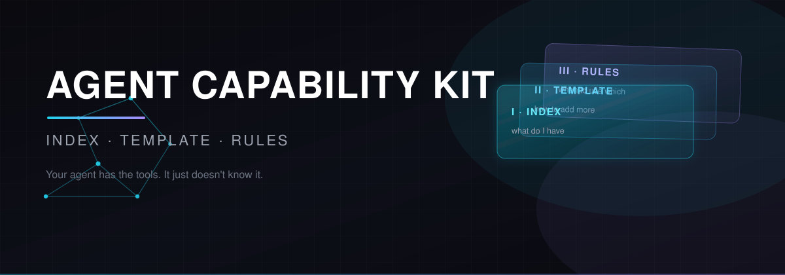

# Agent Capability Kit · 智能体能力套件



> **你的 AI agent 有 375 个技能、39 个插件，但它自己不知道。**
>
> 一套三卷制，让 agent 在动手之前，先知道自己能干什么。

[English](README.md) · [完整方法论文档](MANUAL.zh-CN.md) · [模板](templates/) · [踩坑记录](docs/07-pitfalls.md)

---

## 问题在哪

你给了它一整个工具箱，它却当没看见，从零手搓。

两种失败模式，都在烧钱：

| 失败 | 表现 | 代价 |
|---|---|---|
| **重复造轮子** | 明明有 `pdf` 技能，还是自己写 PDF 代码 | 质量差、慢、容易错 |
| **通读症** | 为了"保险"，把 375 份说明书全读一遍 | 几万 token、拖慢、上下文爆掉 |

**根因：agent 对自己有什么能力，没有一张地图。**

你不可能让人先把整个图书馆的书读一遍，再决定借哪本。

---

## 解法

**两段式查找。**

```
索引   ──►  一行一个能力，375 条也只占很少上下文
              │
              ▼  关键词匹配
说明书 ──►  完整 SKILL.md，只读命中的那一份
              │
              ▼
          按说明书执行
```

再加第三卷，保证这个查找**真的会发生**：

```
system prompt  ──►  "先扫索引。命中就读说明书。别猜。"
```

**整个思路就这一句话。**

---

## 三卷

| 卷 | 文件 | 回答什么 | 缺了会怎样 |
|---|---|---|---|
| **卷一 · 索引** | `SKILLS-INDEX.md` `PLUGINS-INDEX.md` `MCP-INDEX.md` | **我有什么？** | 有规矩但没东西可查 |
| **卷二 · 模板** | `SKILL-TEMPLATE.md` `PLUGIN-TEMPLATE.md` `MCP-TEMPLATE.md` | **怎么扩充？** | 会加，但 agent 发现不了 |
| **卷三 · 规矩** | system prompt（`AGENTS.md` / `CLAUDE.md` / `.cursorrules`） | **什么时候用哪个？** | 一张没人看的地图 |

**三卷必须齐。** 只做一两卷，只是把问题挪个位置。

---

## 为什么要拆成「技能 / 插件 / MCP」三类

这里最容易搞错 —— 三者**不是一回事**：

| | 是什么 | 谁提供 | 怎么装 | 产生什么 | 改完怎么生效 |
|---|---|---|---|---|---|
| **技能** | 干活的**流程说明**（markdown） | 社区 / 自己写 | 放进 `skills/` 目录 | **不产生工具**，靠 `skill({name})` 读 | 重载会话 |
| **插件** | **宿主自己长出来的能力**（npm 包等） | 社区 / 自己写 | 包管理器 + 注册进装载列表 | 插件自定义的工具 | **重启宿主** |
| **MCP** | **把别的程序的能力接进来** | 任何语言的独立程序 | 配置里加 `mcp-*` 条目 | `mcp__<serverName>__<tool>` | **重启宿主** |

**一句话记：**
- 技能 = *怎么干*
- 插件 = *宿主自己长出来的手*
- **MCP = *把别人的手接上***

**为什么必须分三份索引**：三者的**生效时机不同**。混在一份里，agent 会搞错「改完要不要重启宿主」。

---

## 快速开始

### 1. 摸家底（别凭空想象）

```bash
node tools/dump-skills.cjs      # 扫所有 SKILL.md 的 frontmatter
node tools/dump-plugins.cjs     # 读宿主 profile 的 package.json
grep -n "mcp-" <HOST_HOME>/profiles/<profile>/cordis.patch.yml
```

### 2. 生成索引

```bash
node tools/gen-skills-index.cjs     # 自动分类 → SKILLS-INDEX.md
node tools/gen-plugins-index.cjs    # → PLUGINS-INDEX.md
```

### 3. 写规矩 —— **最关键的一步**

把 [`examples/AGENTS.md.example`](examples/AGENTS.md.example) 的内容放进宿主的 system prompt：

| 宿主 | 位置 |
|---|---|
| **DeepSeek Harness** | `<DSH_HOME>/AGENTS.md`（用户级）+ 工作区 `AGENTS.md`（项目级） |
| **OpenClaw** | agent 的 persona / system prompt 配置 |
| **Claude Code** | 项目根 `CLAUDE.md` |
| **Cursor** | `.cursorrules` |
| **自研宿主** | 你自己的 system prompt 拼装逻辑 |

**为什么必须是文件、不是对话里说一句**：对话指令只活一轮；system prompt 文件每次会话开头全文注入。

### 4. 验证

**最硬的测试**：给它一个明显有对应技能的任务。

- 它说「我先查一下技能索引」→ ✅ 生效了
- 它直接开干 → ❌ 没生效，回去检查第 3 步

---

## 实测数据

这套东西是在真实宿主上建起来并测过的，不是画在黑板上的：

| 指标 | 数值 |
|---|---|
| 扫描到的唯一技能 | **375** |
| 自动归类成功 | **375 / 375**（18 个分类，0 个未归类） |
| 插件 | **39**（16 顶层安装 + 4 核心 bundle + 19 子插件） |
| MCP | 2 个（1 个已加载，1 个配了待重启） |
| 生成的索引总体积 | 约 104 KB |
| 环境 | DeepSeek Harness 0.1.7-rc.2 · Windows · Node v25.2.1 |

---

## 七个实测踩过的坑

→ 完整版：[`docs/07-pitfalls.md`](docs/07-pitfalls.md)

最狠的三个：

### ⚠️ 1. 千万别按目录路径归类

我们按 `expert-library/` 目录名把它归成「人物视角」，结果 **217 个风马牛不相及的技能**挤进一个桶 —— 因为那个目录里其实什么都有：Amazon 广告、法律查询、旅行订票、游戏开发。

**分类看内容（name + description），不看路径。** 目录结构反映的是*谁装的*，不是*干什么的*。

### ⚠️ 2. 规矩必须写进 system prompt

| 做法 | 效果 |
|---|---|
| 对话里说一句 | 这轮有效，下轮就忘 |
| 写进 `AGENTS.md` | 每次会话全文注入，**永远在** |

### ⚠️ 3. 索引每项只写一行

索引写长了会拖慢、烧 token —— 而且 agent 会开始*在索引里做判断*，而不是去翻说明书。

**索引是目录，不是内容。**

其余四个：描述为空不处理、分类词表太粗、改完忘记重启、MCP 的 `command` 写相对路径。

---

## 目录结构

```
agent-capability-kit/
├── README.md                      ← 英文版
├── README.zh-CN.md                ← 本文件
├── MANUAL.md                      ← 英文完整方法论（自包含，可交给别的 agent）
├── MANUAL.zh-CN.md                ← 中文完整方法论
├── LICENSE                        ← MIT
├── docs/
│   ├── 05-how-to-replicate.md     ← 复刻步骤
│   └── 07-pitfalls.md             ← 7 个坑详解
├── templates/
│   ├── SKILL-TEMPLATE.md          ← 卷二：技能
│   ├── PLUGIN-TEMPLATE.md         ← 卷二：插件
│   └── MCP-TEMPLATE.md            ← 卷二：MCP
├── examples/
│   ├── AGENTS.md.example          ← 卷三：规矩，可直接照抄
│   └── SKILLS-INDEX.example.md    ← 卷一：索引格式
└── tools/
    ├── README.md
    ├── dump-skills.cjs            ← 扫技能
    ├── gen-skills-index.cjs       ← 自动分类生成
    ├── dump-plugins.cjs           ← 扫插件
    └── gen-plugins-index.cjs      ← 生成插件索引
```

**从哪开始读：**

| 你想… | 读这个 |
|---|---|
| 5 分钟了解全貌 | 本 README |
| 交给另一个 agent | [`MANUAL.zh-CN.md`](MANUAL.zh-CN.md) |
| 动手复刻 | [`docs/05-how-to-replicate.md`](docs/05-how-to-replicate.md) |
| 直接抄规矩 | [`examples/AGENTS.md.example`](examples/AGENTS.md.example) |
| 少踩坑 | [`docs/07-pitfalls.md`](docs/07-pitfalls.md) |

---

## 什么时候该用

**适合：**
- agent 拥有 **20 个以上**技能 / 插件 / MCP
- 你经常发现它「明明有工具却不用」
- 你要 agent 的行为**可预测、可审计、可扩展**
- 你希望多个 agent **共用同一套能力定义**

**没必要：**
- 能力少于 5 个 —— 直接列在 system prompt 里就行
- 能力从不变化 —— 那是一次性配置，不是体系

---

## 来源

「索引 + 说明书」这个模式在 agent 宿主里很常见：一份 `INDEX` 列能力目录，每个能力一份 `SKILL.md` 写步骤，规则固定在 system prompt 里。

本项目**扩展**了四处：

1. **从一卷扩到三卷**（技能 / 插件 / MCP），因为它们的安装和生效机制不同
2. **权限声明规范** —— 插件必须说清读写什么、调什么外部服务
3. **MCP 的安全边界** —— 它是外部程序，权限取决于它自己；「静默降级」是反模式
4. **自动分类工具** —— 超过 100 个能力时，人工分类不可行

**没解决的**：模型能力。这套本质是「读文件 → 判断 → 执行」的多步推理。小模型容易读到一半就放弃或开始猜。这不在系统能控范围内。

---

## 许可

MIT
